# MA Orchestration Demo App

> **Synthetic data / mock activation only.** This is a focused Databricks demo, not a
> production marketing platform. No real messages are ever sent.

A lightweight **Marketing Activation (MA) orchestration** application that consumes an
audience produced by **CustomerLake Campaign Agents** and lets a marketer configure,
approve, dispatch (via **mock** providers), and measure a campaign — with consent
guardrails, an approval workflow, and a full audit trail. State is persisted in
**Delta tables**; the App is built with **APX** (FastAPI + React) and deployed with
**Databricks Asset Bundles (DABs)**.

---

## 1. Architecture & the workspace boundary

The demo is deliberately split across **two workspaces** with a clear responsibility
boundary. This repository is **Workspace B** only.

```mermaid
flowchart LR
  subgraph A["Workspace A — CMEG / CustomerLake (NOT in this repo)"]
    direction TB
    src[(Synthetic source<br/>profile / orders / events)]
    ent[Customer Entity + Attributes]
    aud[Campaign Agents<br/>audience definition + preview]
    src --> ent --> aud
  end

  subgraph B["Workspace B — MA Orchestration App (THIS repo)"]
    direction TB
    repo{{AudienceRepository<br/>replaceable seam}}
    snap[(Local synthetic snapshot<br/>source_type = SYNTHETIC_SNAPSHOT)]
    camp[Campaign setup + wizard]
    elig[Eligibility & consent guardrails]
    appr[Approval workflow]
    disp[Dispatch]
    prov{{ActivationProvider seam<br/>Mock Push / SMS / Coupon}}
    ev[(Delivery events<br/>+ metrics + audit — Delta)]
    repo --> snap --> camp --> elig --> appr --> disp --> prov --> ev
  end

  aud -. "future supported handoff<br/>(shared table / Delta Sharing / API)" .-> repo

  classDef future stroke-dasharray:5 5;
```



**Who owns what**

| Capability | Workspace A (CustomerLake) | Workspace B (this App) |
|---|---|---|
| Source customer data, Entity, Attributes | **Owns** | Does not duplicate |
| Audience definition & preview | **Owns** | Consumes the resulting snapshot |
| Audience handoff | Future supported mechanism | Adapter boundary (`AudienceRepository`) |
| Campaign / offer / message / schedule | — | **Owns** |
| Approval, dispatch, mock channels | — | **Owns** |
| Delivery events, metrics, audit | — | **Owns** (Delta) |
| DAB deployment, tests, teardown | — | **Owns** |

The App **never** recreates or reverse-engineers the Campaign Agents audience logic, and
it **never** writes to any CMEG source object.

### Why a local synthetic snapshot (for demo #1)

A supported cross-workspace audience API is **not assumed** for this first demo. The
audience is therefore materialized as a **local synthetic snapshot** in this workspace,
clearly marked:

```
source_type      = SYNTHETIC_SNAPSHOT
source_workspace = app_workspace
```

This is a temporary demo boundary — **not** a claim that Campaign Agents produces this
exact table, nor that this App can read CMEG directly today.

### Local snapshot audience contract

`ma_app_demo.ma_app.app_audience_members` preserves the audience-member fields
(`customer_id`, `household_id`, name, `email`, `phone`, `country`, `state_province`,
`metro_area`, `loyalty_status`, `loyalty_join_date`, `account_status`,
`preferred_channel`, `customer_segment`, `date_created`, `last_updated`) plus governance
fields (`audience_id`, `audience_version`, `source_type`, `loaded_at`).
`app_audience_catalog` holds the audience metadata (id, name, version, source, member
count). ~2000 synthetic customers; `example.com` emails; non-dialable `555-01xx` phones.

### The replaceable audience seam

`src/ma_app/backend/audience/` defines an `AudienceRepository` protocol. The default
`LocalSnapshotAudienceRepository` reads the snapshot above. A clearly-marked
`SharedTableAudienceRepository` placeholder is selected when
`MA_APP_AUDIENCE_SOURCE_MODE=shared_table`; it validates the configured table exists and
the App service principal has `SELECT`, and **fails clearly** rather than silently
falling back to a different audience.

---

## 2. Configuration (nothing hard-coded)

All workspace-specific values are environment variables / bundle variables.

| Variable | Meaning | Default |
|---|---|---|
| `MA_APP_TARGET_CATALOG` | Catalog for App-owned tables | `ma_app_demo` |
| `MA_APP_APP_SCHEMA` | Schema for App-owned tables | `ma_app` |
| `MA_APP_WAREHOUSE_ID` | SQL Warehouse for all data access | empty → **auto-resolved** from the workspace |
| `MA_APP_WAREHOUSE_NAME` | Preferred warehouse name when auto-resolving | empty |
| `MA_APP_AUDIENCE_SOURCE_MODE` | `local_snapshot` or `shared_table` | `local_snapshot` |
| `MA_APP_AUDIENCE_TABLE` | FQ audience table (shared_table mode) | derived default |
| `MA_APP_REVEAL_PII_ALLOWED` | Permit demo-only reveal toggle | `true` |
| `DATABRICKS_SQL_WAREHOUSE_ID` | Warehouse for the APX sql addon | same warehouse |

Every value has a sensible default and is overridable via env / bundle variables. The
**warehouse id is auto-resolved** from the workspace when unset (prefers `MA_APP_WAREHOUSE_NAME`,
then a running warehouse, then the first available).

- **Setup:** run `./scripts/preflight.sh` — it checks auth, auto-detects the warehouse
  (prompting only if it can't resolve one), confirms catalog/schema, and writes `.env`.
- **Local dev:** `.env` (from preflight, or copy `.env.example`).
- **Deployed App:** `app.yml` (`env:`) carries defaults into the built app.
- **Bundle:** `databricks.yml` `variables` (override per target or with `--var`).

---

## 3. Prerequisites & required Databricks permissions

- Databricks CLI (`databricks`), `apx`, `python3`, `uv`, `bun`.
- A running SQL Warehouse and a catalog you can create schemas in.
- **Your identity** (deployer): create schema/tables in the App catalog; deploy bundles;
  create Apps and jobs.
- **The App service principal** (created with the App): `USE CATALOG` on the App catalog,
  `USE SCHEMA` + `SELECT` + `MODIFY` on the App schema, and `CAN_USE` on the warehouse.
  `scripts/deploy.sh` applies these automatically (least-privilege; scoped to the App
  schema only — **no** write access to any CMEG source).

---

## 4. Deploy

```bash
./scripts/preflight.sh --profile DEFAULT   # auto-detect + write .env (interactive fallback)
./scripts/deploy.sh --profile DEFAULT -t dev
```

`preflight.sh` resolves the profile, SQL warehouse (auto-detected, or an interactive pick
when several exist), and catalog/schema, writing them to `.env`. `deploy.sh` then sources
`.env` and fails fast if anything is missing, performing in order:

1. **Verify CLIs** — `databricks`, `apx`, `python3`.
2. **`databricks bundle validate -t dev`.**
3. **Validate catalog / schema / warehouse** are reachable (SQL check).
4. **`databricks bundle deploy -t dev`** — builds the frontend via `apx build` and
   uploads the App + jobs.
5. **`databricks bundle run ma_app -t dev`** — Databricks Apps must be *started* with a
   `bundle run` after deploy; deploy alone only uploads them.
6. **`databricks bundle run ma_app_setup_job -t dev`** — creates the 9 Delta tables and
   loads the synthetic snapshot (idempotent).
7. **Grant the App service principal** UC + warehouse access — the SP only exists once
   the App is created, so grants are a post-deploy step.
8. **Health check** the App (`GET /health` → `{"status":"ok"}`).
9. **Print the App URL** and demo instructions.

Manual equivalent:

```bash
databricks bundle validate -t dev
databricks bundle deploy  -t dev
databricks bundle run ma_app -t dev
databricks bundle run ma_app_setup_job -t dev
./scripts/print_app_url.sh
```

---

## 5. Access the App

```bash
./scripts/print_app_url.sh --profile DEFAULT
```

Open the URL (Databricks Apps are authenticated). Logs:

```bash
databricks apps logs ma-app --profile DEFAULT
```

---

## 6. Demo walkthrough

1. Open the **Dashboard**.
2. Open the **`lapsed_highvalue`** audience (`AUD-LAPSED-HIGHVALUE`).
3. Review the member count and **masked** sample members (email/phone masked by default).
4. Create a campaign named **`Lapsed High-Value Member Winback`**.
5. Channel = **`APP_PUSH`**.
6. Offer = **`OFFER-020`** (20% Welcome Back).
7. Enter a title, body, and deep link.
8. **Preview** eligibility and exclusions (eligible / skipped-consent / skipped-inactive
   / skipped-invalid-contact / already-dispatched).
9. **Submit for approval.**
10. **Approve** the campaign.
11. **Dispatch** through the **Mock Push Provider**.
12. Open **campaign metrics** (requested / eligible / sent / delivered / opened / clicked
    / redeemed + rates — all computed from Delta).
13. Review **delivery events** and **audit history**.
14. Run the **acceptance test suite** (`./scripts/run_acceptance_tests.sh`).
15. **Tear down** only the App workspace resources when finished.

The demo shows that **Campaign Agents answers "who should be reached?"** while **the App
answers "what is sent, when, through which channel, with what approval and audit
controls?"**

### Optional: real time-based scheduling

Instead of dispatching immediately, an **approved** campaign can be **scheduled**. This is a
*real* trigger (not polling): the App service principal creates a **one-time Databricks job**
(`ma-app-dispatch-<campaign_id>`, a Quartz one-shot at the chosen UTC time) whose `run_job_task`
fires the bundle-defined dispatcher job `ma_app_dispatch_job`, which runs
`CampaignService.dispatch()` in-job (same mock providers + guardrails) → `RUNNING → COMPLETED`.

- **Schedule**: campaign detail → **Schedule** (when `APPROVED`) → pick a time. `POST /api/campaigns/{id}/schedule`.
- **Reconcile/checking job** (`ma_app_reconcile_job`, every 10 min): a **safety net** that dispatches
  any overdue `SCHEDULED` campaign that didn't fire, and **cleans up** spent wrapper jobs.
- **Cancelling** a scheduled campaign (or dispatching it) removes the one-time job.
- Requires the App SP to create/manage jobs; `deploy.sh` grants `CAN_MANAGE_RUN` on the dispatcher.
  In local dev (no deployed dispatcher) `POST /schedule` returns `SCHEDULER_UNAVAILABLE`; immediate
  **Dispatch now** still works. Toggle with `MA_APP_SCHEDULER_ENABLED`.

---

## 7. Tests

```bash
./scripts/run_tests.sh                 # unit (always) + integration (if warehouse configured)
./scripts/run_acceptance_tests.sh      # per-requirement acceptance report
```

Results (JUnit XML + a readable summary) are written to `artifacts/test-results/`.
Unit tests are pure and need no Databricks; integration/acceptance tests use the
configured warehouse and skip cleanly if none is set. An integration-test job
(`ma_app_test_job`) can also run in-workspace via `databricks bundle run ma_app_test_job`.

---

## 8. Switching from local snapshot to a shared source (later)

Only after the handoff mechanism is validated with the product:

```bash
export MA_APP_AUDIENCE_SOURCE_MODE=shared_table
export MA_APP_AUDIENCE_TABLE=<catalog>.<schema>.<audience_table_or_view>
```

The App will validate the table exists and that its service principal has `SELECT`, and
**fail clearly** if the source is unreachable or unauthorized — it never silently falls
back to a different audience. No application code changes are required; only the
`AudienceRepository` implementation selected by config changes.

---

## 9. Teardown (safe by default)

```bash
./scripts/teardown.sh                 # DRY RUN — prints what would be deleted, changes nothing
./scripts/teardown.sh --confirm       # actually removes App-owned resources
./scripts/teardown.sh --confirm --drop-schema   # also drop the (now-empty) App schema
```

Teardown:

- Drops **only** an explicit allowlist of the 9 App-owned tables in
  `ma_app_demo.ma_app` (table-by-table; **no** `DROP SCHEMA CASCADE`).
- Runs `databricks bundle destroy` to remove the App + jobs.
- **Refuses** to run if the configured catalog is anything other than the App catalog.
- **Never** touches CMEG source tables, CustomerLake audience views, any other catalog,
  or any external shared audience table.

---

## 10. Known limitations & non-goals

- **Mock providers only** — no real FCM/APNs, SMS gateway, email, or coupon/CMS
  integration. Providers are deterministic (seed `42`) and produce realistic funnels.
- **Single-workspace demo boundary** — the audience is a local synthetic snapshot; no
  live cross-workspace CustomerLake integration is claimed or performed.
- **Not a full enterprise MA platform** — no journey orchestration, frequency capping,
  deliverability management, unsubscribe center, or closed-loop measurement beyond the
  demo metrics.
- **Synthetic data only** — no real PII; emails are `example.com`, phones are
  non-dialable `555-01xx`.

See `CODE_STRUCTURE.md` for the code map.
